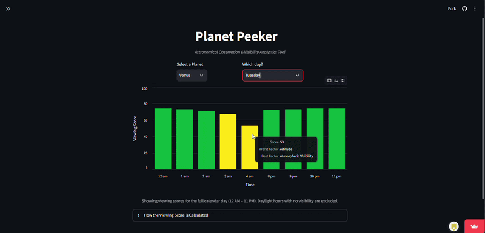

# Planet Peeker
[](https://planet-peeker-gwtm75aghvrkhzahaubagt.streamlit.app/)

> **🚀 Live Demo:** Try out the interactive app live at [Planet Peeker on Streamlit](https://planet-peeker-gwtm75aghvrkhzahaubagt.streamlit.app/)!

## About the Project



Planet Peeker is a planetary observation tool that easily allows users to determine night sky visibility for a planet. Planet Peeker calculates real-time visibility scores based on exact user geolocation (if given access) and displays it in an easy to understand UI chart. 

### Key Features and Highlights:

- Hovering over a selected bar shows a **tooltip** with important information including the exact **visibility score** and the **biggest** and **smallest penalties** affecting the score

- **Factors in the scoring algorithm include**: visibility, cloud coverage, moon illumination, Bortle rating, and planet altitude

- **Note on empty bars:** Some bars may appear empty due to extreme climate interference or a planet altitude falling below the horizon  


<br>

## Built With  

<br>

- [](https://www.python.org/)  
- [](https://streamlit.io/)  
- [](https://altair-viz.github.io/)
- [](https://pandas.pydata.org/)  
- [](https://open-meteo.com/)  
- [](https://rhodesmill.org/skyfield/)  

<br>

## Getting Started

#### To run Planet Peeker locally on your machine:

1. **Clone the repository**

    ```bash 
    git clone https://github.com/villacarter2-a11y/planet-peeker
    cd planet-peeker
    ```
2. **Install Dependencies and Run the App**:
    ```bash
    python -m pip install -r requirements.txt
    python -m streamlit run app.py
## Contact / Author

* **Carter Villa** - [GitHub](https://github.com/villacarter2-a11y) | [LinkedIn](https://www.linkedin.com/in/carter-villa-a32040421/)

